# Predictive Maintenance for Industrial Machinery using LSTM


An LSTM-based system that predicts the Remaining Useful Life (RUL) of turbofan engines and the probability of failure within the next 30 cycles from multivariate sensor time series, with a Streamlit dashboard for monitoring, simulation and uploaded data. Trained and evaluated on NASA C-MAPSS (subset FD001).

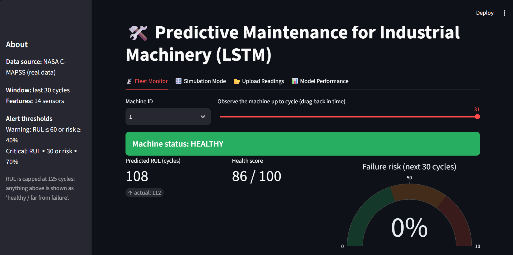

## Table of contents

1. [Problem statement and motivation](#problem-statement-and-motivation)
2. [Applications in Indian manufacturing](#applications-in-indian-manufacturing)
3. [Objectives](#objectives)
4. [Features](#features)
5. [Technology stack](#technology-stack)
6. [System architecture](#system-architecture)
7. [Dataset](#dataset)
8. [Methodology](#methodology)
9. [Results](#results)
10. [Dashboard](#dashboard)
11. [Installation and setup](#installation-and-setup)
12. [Running the project](#running-the-project)
13. [Repository structure](#repository-structure)
14. [Deployment](#deployment)
15. [Limitations](#limitations)
16. [Future improvements](#future-improvements)
17. [Author](#author)
18. [Acknowledgements and citation](#acknowledgements-and-citation)

## Problem statement and motivation

Industrial machines are usually maintained in one of two ways. Reactive maintenance repairs equipment after it fails, which causes unplanned downtime. Fixed-schedule maintenance services equipment at set intervals whether or not it needs it, which wastes time and parts. Predictive maintenance estimates how much useful life a machine has left from its sensor data, so maintenance can be planned just before it is needed.

This project frames that as two learning tasks on the same input:

1. **Regression:** predict the RUL, in operating cycles.
2. **Classification:** predict the probability that the machine fails within the next 30 cycles, which drives the failure-risk percentage and maintenance alerts.

## Applications in Indian manufacturing

The workflow here (sensor windows in, RUL and failure risk out, alert thresholds on top) applies to rotating and thermal equipment such as compressors, pumps, motors, turbines, furnaces and CNC spindles. Typical settings include automotive component plants, steel, cement and power generation. Unplanned stoppages on shared lines or continuous processes are especially costly there.

This repository is a demonstration on a public simulated dataset. It has not been validated on data from any Indian plant, and a real deployment would need the model retrained on that plant's own sensor data.

## Objectives

- Build a complete, reproducible pipeline from raw sensor files to a trained model.
- Predict RUL and short-horizon failure probability with a single LSTM.
- Evaluate honestly against a naive baseline on a held-out test set.
- Provide an interactive dashboard with health status, risk, alerts, a what-if simulator and CSV upload.

## Features

- Time-series preprocessing: cleaning, piece-wise linear RUL labels, normalization, 30-cycle sliding windows.
- Two-head LSTM that outputs RUL and failure probability.
- Metrics: MAE, RMSE, R², NASA asymmetric score, precision, recall, F1, confusion matrix, plus a baseline comparison.
- Streamlit dashboard with four tabs: Fleet Monitor, Simulation Mode, Upload Readings, Model Performance.
- Health status (Healthy, Warning, Critical), failure-risk gauge and rule-based maintenance alerts.
- Simulation: inject wear or shift individual sensors and watch predictions change.
- Upload your own sensor readings as CSV and download the predictions.

## Technology stack

| Area | Tools |
|---|---|
| Language | Python |
| Data | Pandas, NumPy |
| Modelling | TensorFlow / Keras, scikit-learn |
| Visualization | Matplotlib, Plotly |
| Dashboard | Streamlit |

## System architecture

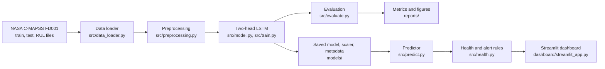

### Workflow

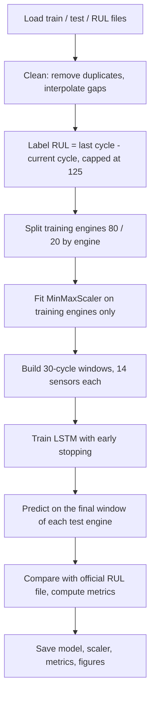

## Dataset

**NASA C-MAPSS (Commercial Modular Aero-Propulsion System Simulation), subset FD001.** Simulated run-to-failure data for turbofan engines.

| Property | FD001 |
|---|---|
| Training engines | 100 (run to failure) |
| Test engines | 100 (stopped before failure; true RUL in `RUL_FD001.txt`) |
| Operating conditions | 1 |
| Fault modes | 1 (high-pressure compressor degradation) |
| Rows (train / test) | 20,631 / 13,096 |

Source: NASA Prognostics Data Repository, mirrored at https://data.phmsociety.org/nasa/ (item "Turbofan Engine Degradation Simulation").

The dataset has temperature, pressure and rotor-speed sensors, but **no vibration channel**.

### Sensors used (14 of 21)

Seven sensors (s1, s5, s6, s10, s16, s18, s19) carry no degradation signal in FD001 and are excluded. The three operational settings are also excluded because FD001 has a single operating condition.

| ID | Measurement | ID | Measurement |
|---|---|---|---|
| s2 | LPC outlet temperature | s12 | Ratio of fuel flow to Ps30 |
| s3 | HPC outlet temperature | s13 | Corrected fan speed |
| s4 | LPT outlet temperature | s14 | Corrected core speed |
| s7 | HPC outlet pressure | s15 | Bypass ratio |
| s8 | Physical fan speed | s17 | Bleed enthalpy |
| s9 | Physical core speed | s20 | HPT coolant bleed |
| s11 | HPC outlet static pressure | s21 | LPT coolant bleed |

## Methodology

### Preprocessing

1. **Cleaning:** drop duplicate rows, convert to numeric, interpolate missing values within each engine.
2. **RUL labels:** for each training row, RUL is the engine's last cycle minus the current cycle, **capped at 125 cycles**. Early in life engines look nearly identical, so a very large RUL is not learnable. Capping is standard practice on this dataset.
3. **Failure label:** 1 if the true RUL is 30 cycles or less, otherwise 0.
4. **Split by engine:** 80 training engines and 20 validation engines. Splitting by engine, not by row, prevents windows from the same engine appearing in both sets.
5. **Normalization:** `MinMaxScaler` fitted on the training engines only.
6. **Windows:** each sample is the last 30 cycles of the 14 sensors (shape 30 x 14). This gives 14,459 training windows and 3,272 validation windows.

### Model architecture

| Layer | Output shape | Parameters |
|---|---|---|
| Input | (30, 14) | 0 |
| LSTM, 64 units, returns sequences | (30, 64) | 20,224 |
| Dropout 0.2 | (30, 64) | 0 |
| LSTM, 32 units | (32) | 12,416 |
| Dropout 0.2 | (32) | 0 |
| Dense, 32 units, ReLU | (32) | 1,056 |
| Output `rul`, linear | (1) | 33 |
| Output `failure`, sigmoid | (1) | 33 |
| **Total** | | **33,762** |

The two heads share the same LSTM features. The RUL head predicts RUL divided by 125, and the failure head predicts the probability of failure within 30 cycles.

### Training

| Setting | Value |
|---|---|
| Loss | MSE on scaled RUL (weight 1.0) + binary cross-entropy on failure (weight 0.5) |
| Optimizer | Adam, learning rate 1e-3 |
| Batch size | 128 |
| Epochs | up to 100 |
| Early stopping | monitor validation loss, patience 15, restore best weights |
| Learning-rate schedule | halve the rate after 4 epochs without validation improvement |
| Random seed | 42 |

The reported run used `python -m src.train --epochs 100 --patience 15` and stopped after 32 epochs. Hyperparameters were chosen using validation loss only, never the test set.

### Evaluation protocol

- The model predicts once per test engine, from the final 30 cycles it observes.
- Predictions are compared with the official `RUL_FD001.txt`, with true RUL capped at 125 to match the training target. Metrics against uncapped RUL would look worse.
- The failure classifier uses a probability threshold of 0.5. An engine counts as truly failing if its true RUL is 30 cycles or less (25 of the 100 test engines).
- The baseline predicts the mean training RUL for every engine.

## Results

All numbers below come from `reports/metrics.json`, computed on the 100 official FD001 test engines.

### RUL prediction

| Metric | LSTM | Baseline (always predict the mean) |
|---|---|---|
| MAE (cycles) | 10.40 | 34.83 |
| RMSE (cycles) | 13.91 | 41.94 |
| R² | 0.880 | n/a |
| NASA score (lower is better) | 267.8 | n/a |

### Failure within 30 cycles

| Metric | Value |
|---|---|
| Precision | 0.952 |
| Recall | 0.800 |
| F1 | 0.870 |
| Accuracy | 0.940 |

| | Predicted not failing | Predicted failing |
|---|---|---|
| **Actually not failing** | 74 | 1 |
| **Actually failing** | 5 | 20 |

Of the 21 alerts raised, 20 were correct. Of the 25 engines that were truly within 30 cycles of failure, 20 were caught and 5 were missed.

### Visualizations

| Actual vs predicted RUL | RUL over an engine's life |
|---|---|
| 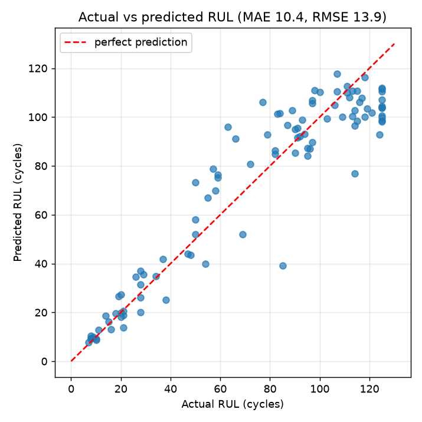 | 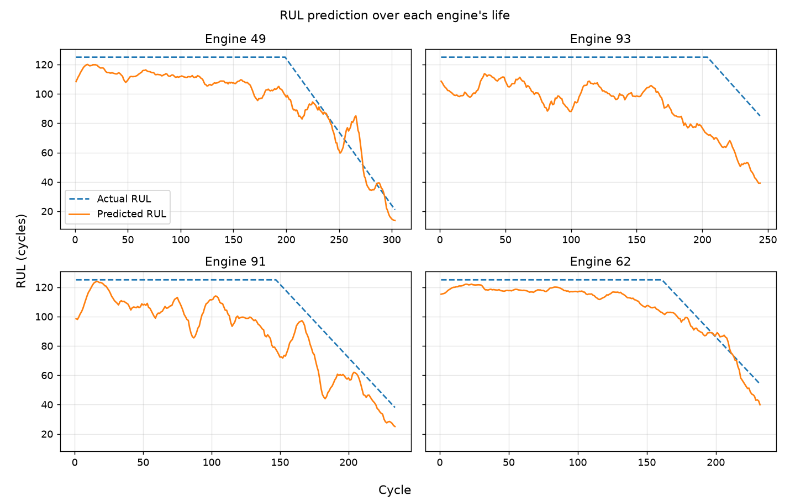 |

| Per-engine comparison | Confusion matrix |
|---|---|
| 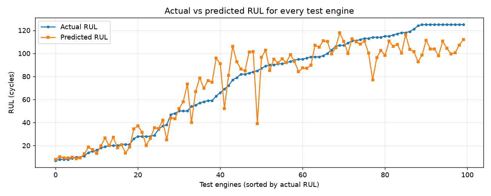 | 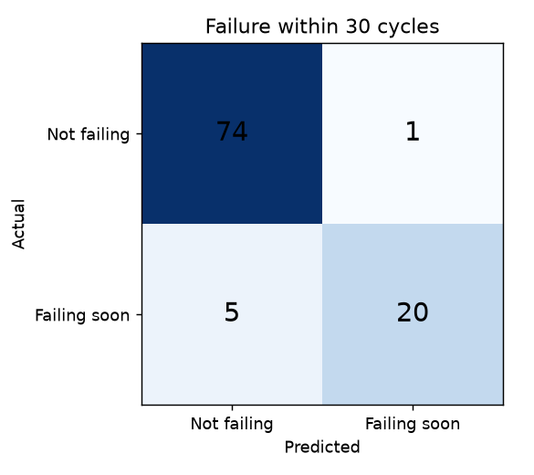 |

| Training curves | Error distribution |
|---|---|
| 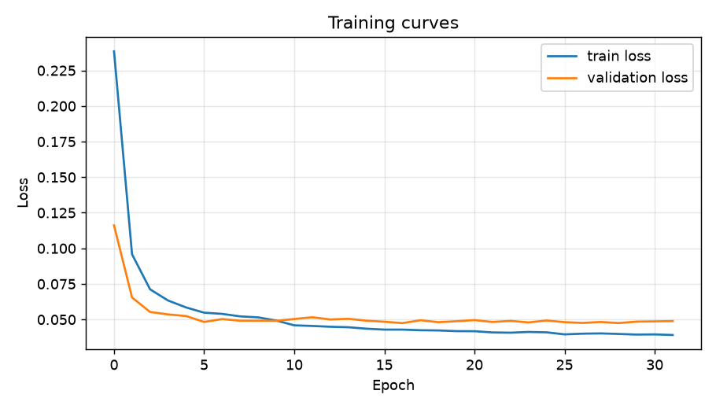 | 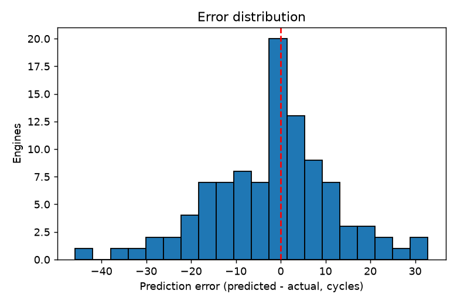 |

### Reproducibility note

Training with the same seed on a different machine produced slightly different results (an earlier run gave MAE 10.27, RMSE 13.73 and recall 0.84, that is 21 of 25 failures caught). Neural-network results vary with hardware and library versions, and the test set contains only 25 failing engines, so one engine moves recall by 4 percentage points. Treat the figures above as one run, not a precise estimate. The numbers in this README belong to the committed model in `models/`.

## Dashboard

```bash
streamlit run dashboard/streamlit_app.py
```

### Fleet Monitor

Select a machine and drag the slider back in time. Shows status, predicted RUL against the actual RUL, health score, failure-risk gauge, maintenance alerts and sensor trends.

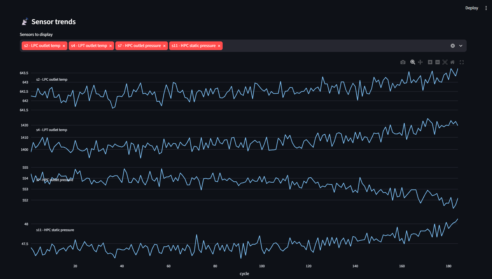
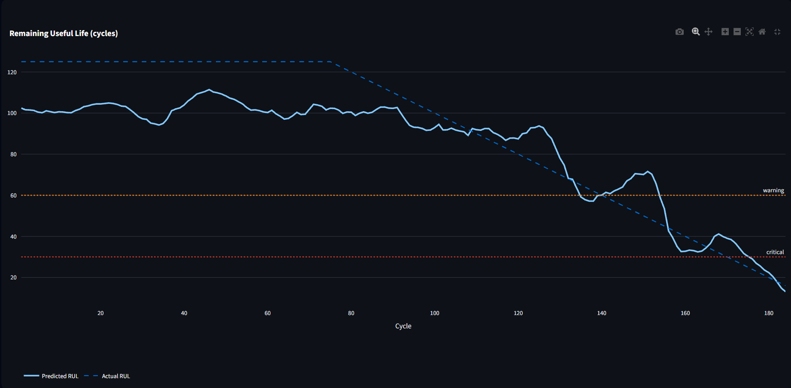
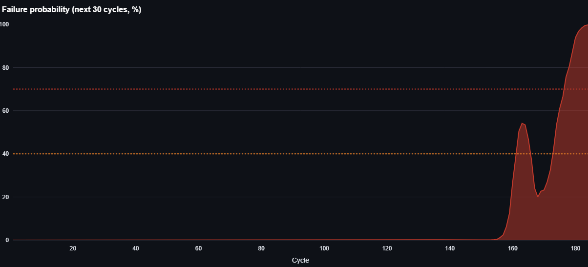
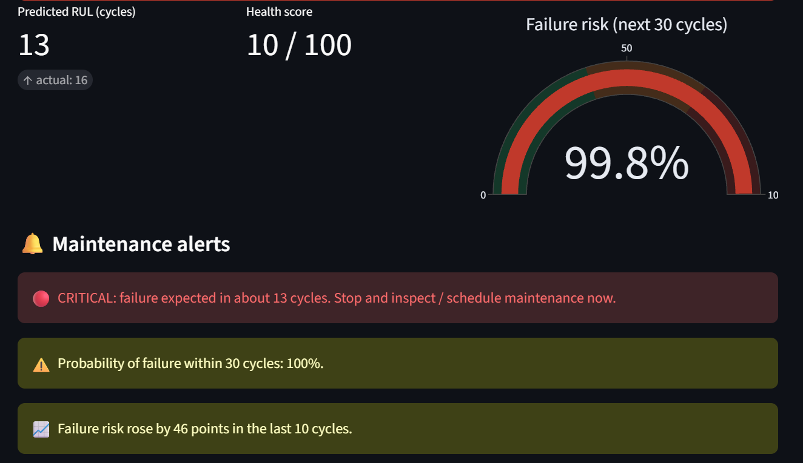

### Simulation Mode

Start from a real machine's recent 30 cycles, then inject typical end-of-life wear or shift individual sensors by multiples of their standard deviation. Original and simulated RUL and risk are shown side by side.

| Baseline | Wear injected |
|---|---|
| 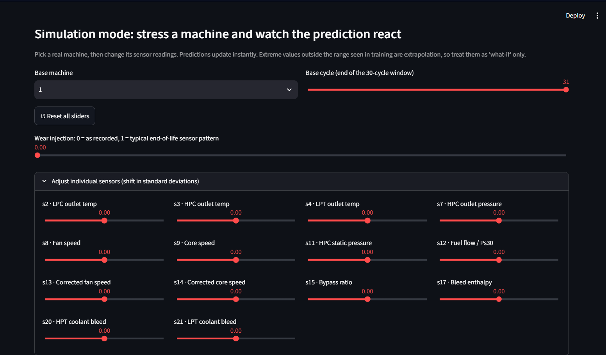 | 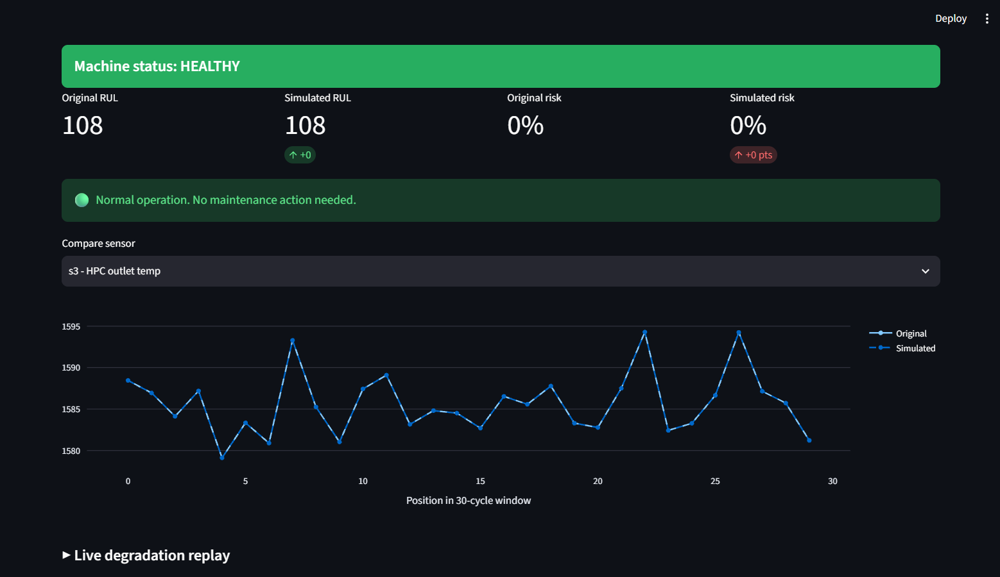 |

Values far outside the range seen in training are extrapolation, so the simulator is a what-if tool and not a validated physical model.

### Upload Readings

Upload a CSV with the 14 sensor columns used by the model (`s2, s3, s4, s7, s8, s9, s11, s12, s13, s14, s15, s17, s20, s21`) and optional `unit` and `cycle` columns. Three sample files from real test engines are in `data/sample/`. A raw 26-column C-MAPSS `.txt` file also works.

### Model Performance

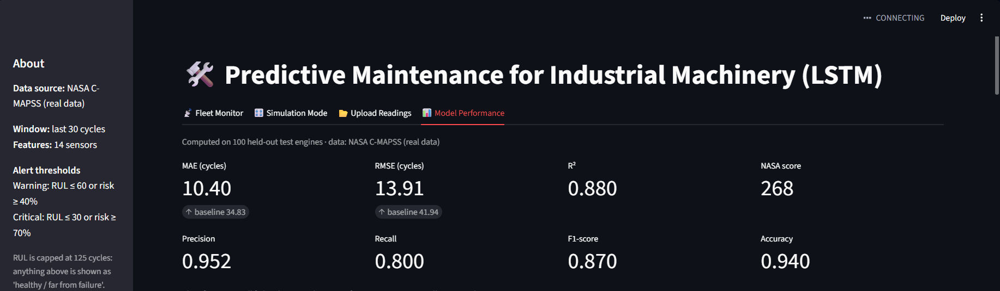

### Alert rules

| Status | Condition |
|---|---|
| Warning | predicted RUL of 60 cycles or less, or failure probability of 40% or more |
| Critical | predicted RUL of 30 cycles or less, or failure probability of 70% or more |

Thresholds are set in `config.py` and are illustrative. A real plant would set them from maintenance lead times and the cost of downtime compared with early servicing.

## Installation and setup

Tested with Python 3.12 and 3.13. TensorFlow runs on CPU here (native Windows TensorFlow has no GPU support), and the model is small enough for a normal laptop.

```bash
git clone https://github.com/rachel-d-07/predictive-maintenance-lstm.git
cd predictive-maintenance-lstm
python -m venv venv
```

Activate the environment:

```bash
# Windows (PowerShell)
venv\Scripts\activate
# macOS / Linux
source venv/bin/activate
```

On PowerShell, if activation is blocked, run `Set-ExecutionPolicy -Scope Process -ExecutionPolicy Bypass` first. Then:

```bash
pip install -r requirements.txt
```

### Download the dataset

The NASA files are not stored in this repository. Download the Turbofan Engine Degradation Simulation data from https://data.phmsociety.org/nasa/, extract it, and copy these three files into `data/raw/`:

```
train_FD001.txt
test_FD001.txt
RUL_FD001.txt
```

Check the line counts (they should be 20631, 13096 and 100):

```powershell
(Get-Content data\raw\train_FD001.txt).Count
(Get-Content data\raw\test_FD001.txt).Count
(Get-Content data\raw\RUL_FD001.txt).Count
```

If `data/raw/` is empty, the code falls back to generated **synthetic** data and the dashboard sidebar shows a warning. Do not use results from synthetic data as real-data results.

## Running the project

```bash
# 1. Train and evaluate (writes models/ and reports/)
python -m src.train --epochs 100 --patience 15

# 2. Launch the dashboard
streamlit run dashboard/streamlit_app.py
```

Optional:

```bash
# Rebuild the demo upload files from real test engines (needs a trained model)
python -m src.make_demo_files
```

## Repository structure

```
predictive-maintenance-lstm/
├── config.py                 settings: paths, features, window, thresholds
├── requirements.txt
├── LICENSE
├── dashboard/
│   └── streamlit_app.py      Streamlit dashboard
├── src/
│   ├── data_loader.py        load NASA files (or synthetic fallback)
│   ├── preprocessing.py      cleaning, RUL labels, scaling, windows
│   ├── model.py              two-head LSTM
│   ├── train.py              training entry point
│   ├── evaluate.py           metrics and figures
│   ├── predict.py            inference helpers used by the dashboard
│   ├── health.py             status, risk and alert rules
│   ├── generate_sample_data.py   synthetic fallback data
│   └── make_demo_files.py    demo CSVs from real test engines
├── data/
│   ├── raw/                  put NASA files here (not tracked)
│   └── sample/               demo upload files
├── models/                   trained model, scaler, metadata
├── reports/                  metrics.json, test_predictions.csv, figures/
└── screenshots/              dashboard screenshots used in this README
```

## Deployment

**Status: not deployed.** This section will be updated with a public URL only after a deployment has been completed and tested.

## Limitations

- **Simulated data:** C-MAPSS is generated by a simulator. Results do not show how the model would perform on real plant data.
- **Simplest subset:** FD001 has one operating condition and one fault mode. The other subsets (FD002 to FD004) are harder and are not evaluated here.
- **Small test set:** 100 engines, of which only 25 are in the failure zone, so classification metrics are approximate.
- **Single configuration and run:** no hyperparameter search, and no averaging over several random seeds.
- **Capped RUL:** the model cannot tell 125 cycles remaining from 300, and metrics are measured against capped RUL.
- **No vibration data:** the dataset has no vibration channel.
- **Uncalibrated probabilities:** the failure probability has not been checked for calibration.
- **Illustrative alert thresholds:** not derived from real maintenance costs.
- **Data fallback:** if the NASA files are missing, the code silently uses synthetic data and only the sidebar warning tells you.

## Future improvements

- Evaluate on FD002 to FD004, with per-operating-condition normalization.
- Average results over multiple seeds and report the spread.
- Compare against GRU, 1D-CNN, temporal convolutional network and Transformer baselines.
- Add uncertainty estimates for RUL and calibrate the failure probability.
- Choose the alert threshold from a cost model of missed failures against false alarms.
- Add unit tests and continuous integration.
- Adapt the pipeline to real vibration and process data, with retraining per machine type.

## Author

**Rachel D'souza**
MSc Artificial Intelligence and Machine Learning, MIT-ADT University, Pune
GitHub:(https://github.com/rachel-d-07) | LinkedIn:https://www.linkedin.com/in/rachel-dsouza07

## Acknowledgements and citation

- NASA Prognostics Center of Excellence for the C-MAPSS dataset.
- Dataset reference: A. Saxena and K. Goebel (2008). "Turbofan Engine Degradation Simulation Data Set." NASA Prognostics Data Repository, NASA Ames Research Center, Moffett Field, CA.
- Built with TensorFlow/Keras, scikit-learn, Pandas, NumPy, Matplotlib, Plotly and Streamlit.

## License

Released under the MIT License. See [LICENSE](LICENSE).
